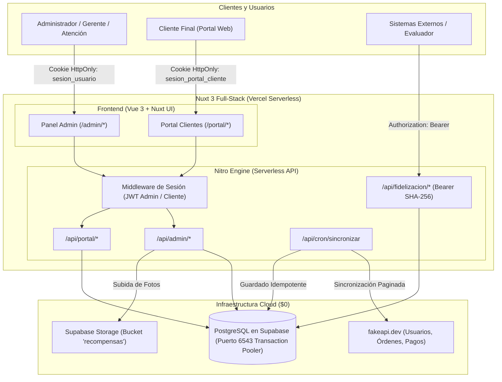
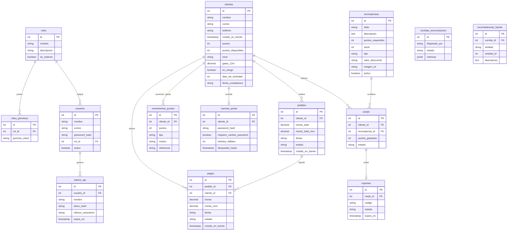

# 🏆 Plataforma de Fidelización y Lealtad de Clientes

Sistema full-stack de alta disponibilidad para la gestión, cálculo y redención de programas de lealtad en comercio electrónico. Construido con **Nuxt 3 (Vue 3)**, **Supabase PostgreSQL** (Transaction Pooler PgBouncer), **Drizzle ORM** y desplegado sobre infraestructura serverless en **Vercel** ($0 costo operativo).

---

## 📌 Tabla de Contenidos

- [Características Principales](#-características-principales)
- [Stack Tecnológico](#-stack-tecnológico)
- [Arquitectura del Sistema](#-arquitectura-del-sistema)
- [Modelo de Base de Datos (14 Tablas)](#-modelo-de-base-de-datos-14-tablas)
- [Motor de Fidelización y Reglas de Negocio](#-motor-de-fidelización-y-reglas-de-negocio)
- [Seguridad y Matriz de Roles / Permisos](#-seguridad-y-matriz-de-roles--permisos)
- [Endpoints Oficiales de Evaluación](#-endpoints-oficiales-de-evaluación)
- [Instalación y Puesta en Marcha Local](#-instalación-y-puesta-en-marcha-local)
- [Preguntas Clave y Justificaciones Arquitectónicas](#-preguntas-clave-y-justificaciones-arquitectónicas)

---

## 🚀 Características Principales

1. **Panel Administrativo Integral:**
   - Métricas en tiempo real: distribución de clientes por nivel (Bronce, Plata, Oro), top clientes por puntos y alertas de riesgo.
   - Directorio de clientes con búsqueda reactiva, visualización de saldo de puntos, histórico de compras y generación de accesos al portal.
   - Gestión de catálogo de recompensas con control de stock, fotos alojadas en Supabase Storage y estados activo/inactivo.
   - Auditoría y gestión de canjes con estados (Pendiente, Entregado, Cancelado) y reversión atómica de puntos ante cancelaciones.
   - Listas operativas: detección de clientes en riesgo de abandono (>90 días sin compras) y próximos cumpleaños (ventana de 30 días) con exportación a CSV.
   - Control de acceso basado en roles (RBAC) con permisos granulares y generación de tokens de API con hash SHA-256.

2. **Portal de Autoservicio del Cliente:**
   - Interfaz web independiente y responsiva para que el cliente consulte sus puntos acumulados, nivel actual y progreso.
   - Catálogo interactivo de recompensas con validación visual de suficiencia de saldo de puntos.
   - Canje atómico en tiempo real con generación de cupón único alfanumérico (`LEAL-XXXX-XXXX`).
   - Autenticación criptográfica dedicada (JWT aislado en cookie `httpOnly`), bloqueo tras 5 intentos fallidos y flujo obligatorio de cambio de contraseña temporal en primer ingreso.

3. **Motor de Sincronización e Idempotencia:**
   - Consumo del API externa (`fakeapi.dev`) con paginación automática (`per_page=100`), reintentos y tolerancia a fallos.
   - Normalización de divisas a MXN y corte histórico estricto (`2026-04-30`).
   - Tarea cron automatizada (`/api/cron/sincronizar`) protegida con encabezado `CRON_SECRET` y botón de sincronización manual con registro de corridas e inconsistencias.

---

## 🛠️ Stack Tecnológico

| Capa | Tecnología | Propósito |
|---|---|---|
| **Framework Full-Stack** | Nuxt 3 (Vue 3, Nitro) | Renderizado híbrido SSR/SPA y endpoints serverless optimizados para Vercel. |
| **Diseño y Componentes** | Nuxt UI v3 + Tailwind CSS v4 | Biblioteca de componentes de alta fidelidad, accesibilidad nativa y micro-interacciones. |
| **Base de Datos** | PostgreSQL (Supabase) | Motor relacional robusto con llaves foráneas, índices compuestos y constraints de unicidad. |
| **Conexión a Base de Datos** | PgBouncer / Transaction Pooler (Puerto 6543) | Multiplexación de conexiones PostgreSQL para evitar saturación en entornos serverless. |
| **ORM** | Drizzle ORM | Mapeo objeto-relacional ligero, tipado de extremo a extremo sin sobrecarga de memoria. |
| **Criptografía** | bcryptjs + jose (JWT) | Hashing seguro de contraseñas y tokens criptográficos firmados para sesiones web y tokens API (SHA-256). |
| **Almacenamiento de Archivos** | Supabase Storage (S3 API) | Bucket público `recompensas` para imágenes de premios y productos canjeables. |
| **Gestor de Paquetes** | pnpm | Rendimiento superior e instalación determinista con enlaces simbólicos. |

---

## 🏛️ Arquitectura del Sistema



---

## 🗄️ Modelo de Base de Datos (14 Tablas)

La base de datos sigue una estructura relacional rigurosa organizada al estilo Laravel:



---

## 🎯 Motor de Fidelización y Reglas de Negocio

El cálculo de lealtad se ejecuta de manera determinista en base a funciones puras auditables:

1. **Fecha de Corte:**
   - Se procesan pedidos y pagos efectuados hasta el **30 de abril de 2026 inclusive** (`2026-04-30T23:59:59.999Z`).

2. **Conversión a MXN Oficial:**
   - `1 USD = 20.00 MXN`
   - `1 EUR = 22.00 MXN`
   - `1 MXN = 1.00 MXN`

3. **Cálculo de Puntos por Compra:**
   - Únicamente compras con estado de pago **`paid`** acumulan puntos.
   - Fórmula: `Puntos Base = floor(monto_mxn / 10)`. (1 punto por cada $10 MXN).
   - **Bono por Volumen:** Compras de más de $1,000 MXN reciben **+50 puntos adicionales** por transacción.

4. **Niveles de Cliente (Tiers):**
   - El nivel se calcula evaluando el total de puntos históricos acumulados:
     - 🥉 **Bronce:** 0 a 499 puntos acumulados.
     - 🥈 **Plata:** 500 a 1,499 puntos acumulados.
     - 🥇 **Oro:** 1,500 puntos o más acumulados.

5. **Ventana de Gasto de los Últimos 12 Meses (`gasto_12m`):**
   - Intervalo móvil: Del **1 de mayo de 2025 al 30 de abril de 2026**.
   - Solo se contabilizan pagos efectivamente completados (`paid`).

6. **Detección de Clientes en Riesgo de Abandono (`en_riesgo`):**
   - Un cliente se cataloga en riesgo (`en_riesgo = true`) si han transcurrido **más de 90 días naturales** desde su última compra hasta la fecha de corte (`2026-04-30`).

7. **Ventana de Próximos Cumpleaños:**
   - Clientes que cumplen años dentro de los siguientes **30 días naturales** posteriores a la fecha de corte (`2026-05-01` al `2026-05-31`).

8. **Garantía de Idempotencia en Sincronización:**
   - La tabla `movimientos_puntos` posee una restricción única: `(cliente_id, tipo, referencia)` donde la referencia sigue el patrón `pago:{id}`.
   - Ejecutar la sincronización múltiples veces jamás duplica puntos ni afecta canjes existentes de clientes (`tipo = canje`).

9. **Canje Concurrente y Atómico de Recompensas:**
   - Al solicitar un canje, se abre una transacción en PostgreSQL con bloqueo pesimista `SELECT ... FOR UPDATE` sobre la fila de la recompensa.
   - Se verifica que el stock sea mayor a 0 y que `puntos_disponibles >= puntos_requeridos`.
   - Se decrementa el stock, se inserta el movimiento negativo en `movimientos_puntos`, se descuentan los puntos del cliente y se genera el cupón en la misma unidad atómica. Si dos clientes intentan canjear la última unidad al mismo milisegundo, uno triunfa y el segundo recibe error 400 sin inconsistencias.

---

## 🔐 Seguridad y Matriz de Roles / Permisos

El sistema implementa dos canales de autenticación estrictamente aislados:

1. **Sesión del Panel Administrativo:** Cookie `sesion_usuario` (`httpOnly`, `SameSite=Lax`, `Secure` en producción) que almacena el JWT con `usuarioId` y `rolId`.
2. **Sesión del Portal del Cliente:** Cookie `sesion_portal_cliente` (`httpOnly`, `SameSite=Lax`) que almacena el JWT con `clienteId` y `correo`.

### Matriz de Permisos por Rol

| Permiso Clave | Descripción | Administrador | Gerente | Atención a clientes |
|---|---|:---:|:---:|:---:|
| `dashboard:ver` | Ver métricas y distribución de niveles | ✅ | ✅ | ✅ |
| `clientes:listar` | Consultar catálogo y búsqueda de clientes | ✅ | ✅ | ✅ |
| `clientes:detalle` | Ver ficha individual del cliente | ✅ | ✅ | ✅ |
| `clientes:financiero` | Ver montos de gasto en dinero real (MXN) | ✅ | ✅ | ❌ |
| `clientes:acceso` | Generar y resetear claves temporales | ✅ | ✅ | ❌ |
| `recompensas:listar` | Consultar catálogo de recompensas | ✅ | ✅ | ✅ |
| `recompensas:gestionar` | Crear, editar y cambiar stock de recompensas | ✅ | ✅ | ❌ |
| `canjes:gestionar` | Marcar canjes como entregados o cancelados | ✅ | ✅ | ✅ |
| `reportes:exportar` | Descargar reportes de riesgo y cumpleaños en CSV | ✅ | ✅ | ❌ |
| `sincronizacion:ejecutar` | Disparar sincronización manual con fakeapi | ✅ | ❌ | ❌ |
| `seguridad:usuarios` | Administrar usuarios y credenciales del equipo | ✅ | ❌ | ❌ |
| `seguridad:roles` | Crear y editar roles y asignación de permisos | ✅ | ❌ | ❌ |

---

## 📡 Endpoints Oficiales de Evaluación

Todos los endpoints oficiales de evaluación soportan solicitudes con encabezado `Authorization: Bearer <TOKEN>` y responden con los encabezados de CORS habilitados (`Access-Control-Allow-Origin: *`, `OPTIONS`).

### 1. Ficha del Cliente
```http
GET /api/fidelizacion/clientes/{id}
Authorization: Bearer <TOKEN_API>
```
**Respuesta:**
```json
{
  "id": 1,
  "nombre": "Lauryn Schowalter",
  "correo": "samanta.gleichner@example.com",
  "telefono": "870-761-0428",
  "puntos": 487,
  "puntosDisponibles": 487,
  "nivel": "Bronce",
  "gasto12m": 3870.00,
  "enRiesgo": false,
  "diasSinActividad": 12,
  "fechaCumpleanos": "1992-05-14"
}
```

### 2. Clientes en Riesgo de Abandono
```http
GET /api/fidelizacion/riesgo?limite=10&pagina=1
Authorization: Bearer <TOKEN_API>
```

### 3. Próximos Cumpleaños (Ventana 30 Días)
```http
GET /api/fidelizacion/cumpleanos?dias=30
Authorization: Bearer <TOKEN_API>
```

### 4. Tarea Cron de Sincronización
```http
GET /api/cron/sincronizar
Authorization: Bearer <CRON_SECRET>
```

---

## 💻 Instalación y Puesta en Marcha Local

### Prerrequisitos
- Node.js 20.x o 22.x
- pnpm (`npm install -g pnpm`)

### Pasos
1. **Clonar el repositorio:**
   ```bash
   git clone https://github.com/A1exauri0/ProgramaLealtad.git
   cd ProgramaLealtad
   ```

2. **Instalar dependencias:**
   ```bash
   pnpm install
   ```

3. **Configurar variables de entorno:**
   Copiar `.env.example` a `.env` y completar los valores requeridos:
   ```bash
   cp .env.example .env
   ```

4. **Ejecutar migraciones y seeders iniciales:**
   ```bash
   pnpm db:migrate
   pnpm db:seed
   ```

5. **Iniciar el servidor de desarrollo:**
   ```bash
   pnpm dev
   ```
   La aplicación se abrirá en `http://localhost:3000`.

---

## 💡 Preguntas Clave y Justificaciones Arquitectónicas

### 1. ¿Por qué Nuxt 3 (Vue 3) en lugar de arquitecturas separadas?
> **Respuesta:** Nuxt 3 ofrece una arquitectura full-stack unificada con motor Nitro en el backend. Los endpoints en `server/api/` se compilan automáticamente como Vercel Serverless Functions ($0 costo), mientras que la Composition API de Vue 3 (`<script setup>`, `ref`, `computed`) permite interfaces reactivas, modulares y de alto rendimiento.

### 2. ¿Por qué conectarse a Supabase por el puerto 6543 en lugar del 5432?
> **Respuesta:** En entornos serverless, cada invocación de función abre conexiones efímeras a la base de datos. Si se utilizara el puerto directo (5432), se agotaría en segundos el límite de conexiones concurrentes de PostgreSQL. El puerto 6543 pasa por el **Transaction Pooler (PgBouncer)** de Supabase, que multiplexa miles de transacciones sobre un conjunto controlado de conexiones físicas.

### 3. ¿Cómo se garantiza que sincronizar dos veces no altere los saldos?
> **Respuesta:** Mediante una restricción única compuesta en la tabla `movimientos_puntos`: `(cliente_id, tipo, referencia)` donde la referencia es `pago:{id}`. Si el movimiento ya existe, Drizzle/Postgres ignora la inserción sin duplicar puntos. Además, los canjes de clientes son transacciones con tipo `canje` que el motor de sincronización jamás toca.

### 4. ¿Cómo se resuelve el canje concurrente del último producto en stock?
> **Respuesta:** Se resuelve en una transacción SQL atómica con bloqueo pesimista `SELECT ... FOR UPDATE` sobre la recompensa. Se verifica en el mismo milisegundo que el stock sea mayor a cero y que el saldo del cliente alcance. Si dos clientes canjean a la vez, la base de datos encola el segundo proceso; el primero descuenta el stock a 0 y el segundo aborta de inmediato con mensaje de falta de stock, previniendo sobreventas o inventario negativo.
