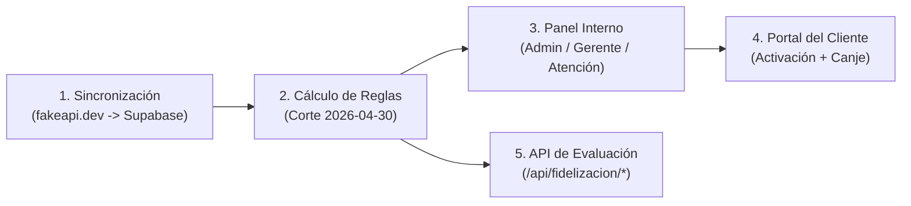
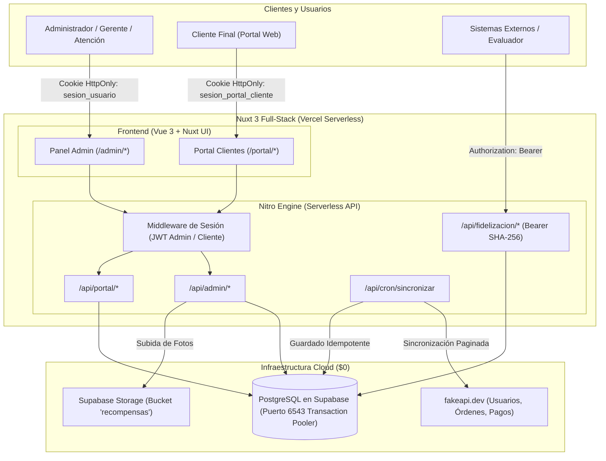
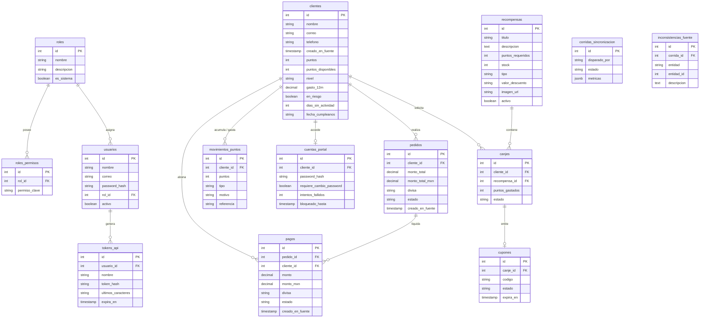

# 🏆 Plataforma de Fidelización y Lealtad de Clientes

Sistema full-stack de alta disponibilidad para la gestión, cálculo y redención de programas de lealtad en comercio electrónico. Construido con **Nuxt 3 (Vue 3)**, **Supabase PostgreSQL** (Transaction Pooler PgBouncer), **Drizzle ORM** y desplegado sobre infraestructura serverless en **Vercel** ($0 costo operativo).

---

## 📌 Tabla de Contenidos

- [¿De qué va el sistema y cuál es su flujo completo?](#-de-qué-va-el-sistema-y-cuál-es-su-flujo-completo)
- [Características Principales](#-características-principales)
- [Stack Tecnológico](#-stack-tecnológico)
- [Arquitectura del Sistema](#-arquitectura-del-sistema)
- [Modelo de Base de Datos (14 Tablas)](#-modelo-de-base-de-datos-14-tablas)
- [Motor de Fidelización y Reglas de Negocio](#-motor-de-fidelización-y-reglas-de-negocio)
- [Seguridad y Matriz de Roles / Permisos](#-seguridad-y-matriz-de-roles--permisos)
- [Endpoints Oficiales de Evaluación](#-endpoints-oficiales-de-evaluación)
- [Instalación y Puesta en Marcha Local](#-instalación-y-puesta-en-marcha-local)
- [Preguntas Clave y Justificaciones Arquitectónicas](#-preguntas-clave-y-justificaciones-arquitectónicas)

---

## 📖 ¿De qué va el sistema y cuál es su flujo completo?

Imagina que una **tienda en línea** ya tiene su propio sistema donde registra a sus clientes (`/users`), sus pedidos (`/orders`) y sus cobros (`/payments`), expuestos en la API externa `fakeapi.dev`. La tienda quiere premiar a sus compradores frecuentes lanzando un **Programa de Lealtad**, sin modificar su tienda original.

Este sistema resuelve ese problema en **5 pasos conectados (El Flujo Completo)**:



1. **Paso 1 — Ingesta y Sincronización (`fakeapi.dev` $\rightarrow$ Nuestra Base de Datos):**
   - Una tarea programada diaria (`/api/cron/sincronizar`) o el botón **"Sincronizar fakeapi.dev"** del Administrador descarga todos los clientes, pedidos y pagos desde `fakeapi.dev` usando la API Key secreta en el servidor.
   - Guarda los datos normalizados en **Supabase PostgreSQL** y crea a cada cliente una cuenta de portal inicialmente en estado `sin_acceso`.
2. **Paso 2 — Motor de Reglas de Fidelización (Corte fijo al `2026-04-30`):**
   - Convierte las fechas de UTC a hora del centro de México (`UTC-6`) e ignora todo lo posterior al `2026-04-30`.
   - Convierte los pagos a pesos mexicanos (`MXN`) y calcula el **historial de movimientos de puntos**:
     - **+1 punto por cada \$10 MXN** en pagos exitosos (`succeeded`).
     - Si un pago fue reembolsado (`refunded`), registra los puntos positivos y enseguida un movimiento negativo igual (efecto neto `0`).
     - **+250 puntos de bono** por cada pedido entregado y pagado (`delivered` + `paid`).
   - Suma cuánto gastó el cliente en los últimos 12 meses (`2025-05-01` al `2026-04-30`) y le asigna su **Nivel**: **Bronce** (< \$150,000), **Plata** (\$150,000 a \$400,000) u **Oro** (> \$400,000).
   - Detecta quién está **En Riesgo** (clientes con compras previas que llevan 90 días o más sin actividad al corte) y quién **Cumple Años** en los próximos 7 días (`30 de abril` al `7 de mayo`).
3. **Paso 3 — Operación del Equipo Interno (`/admin`):**
   - El personal de la tienda entra en `/login` según su rol (**Administrador**, **Gerente** o **Atención a clientes**).
   - Consulta el Dashboard, busca clientes, revisa quién está en riesgo o cumple años, administra el catálogo de **Recompensas** (productos físicos con stock o cupones de descuento) y supervisa los **Canjes**.
   - Si el usuario es de *Atención a clientes*, el backend oculta todos los montos en dinero (`$`).
4. **Paso 4 — Activación y Autoservicio en el Portal del Cliente (`/portal`):**
   - Cuando un cliente quiere entrar a su portal, alguien del equipo interno entra a su ficha (`/admin/clientes/[id]`) y presiona **"Generar Acceso"**. El sistema genera una contraseña temporal aleatoria (`Leal-XXXXXX`) que se muestra una sola vez.
   - El cliente entra en `/portal/login` con su correo y esa clave temporal. En su **primer ingreso**, el sistema lo obliga a elegir una contraseña nueva personal (`/portal/cambiar-password`).
   - Dentro de `/portal`, el cliente ve **únicamente sus propios datos**: saldo de puntos disponibles, nivel actual, cuánto le falta para subir de nivel, su historial y el catálogo de premios.
   - Cuando canjea una recompensa (`/api/portal/canjear`), se ejecuta una **transacción Todo o Nada**: se descuentan sus puntos, se resta 1 al stock y se genera un pedido de entrega (`pendiente`) o un código de cupón único (`LEAL-XXXX-XXXX`). Si desde el panel interno se cancela ese canje, el sistema devuelve el stock y regresa los puntos con un movimiento `devolucion`.
5. **Paso 5 — Validación Automática del Evaluador (`/api/fidelizacion/*`):**
   - El evaluador externo consume los 3 endpoints públicos (`/clientes/{id}`, `/riesgo`, `/cumpleanos`) enviando un token `Authorization: Bearer <token>` (cuyo hash `SHA-256` vive en la base de datos) para calificar automáticamente que todos los cálculos cuadren con su hoja de respuestas.

---

## 🚀 Características Principales

1. **Panel Administrativo Integral:**
   - Métricas en tiempo real: distribución de clientes por nivel (Bronce, Plata, Oro), top clientes por puntos y alertas de riesgo.
   - Directorio de clientes con búsqueda reactiva, visualización de saldo de puntos, histórico de compras y generación de accesos al portal.
   - Gestión de catálogo de recompensas con control de stock, fotos alojadas en Supabase Storage y estados activo/inactivo.
   - Auditoría y gestión de canjes con estados (Pendiente, Entregado, Cancelado) y reversión atómica de puntos ante cancelaciones.
   - Listas operativas: detección de clientes en riesgo de abandono (>90 días sin compras) y próximos cumpleaños (ventana de 30 días) con exportación a CSV.
   - Control de acceso basado en roles (RBAC) con permisos granulares y generación de tokens de API con hash SHA-256.

2. **Portal de Autoservicio del Cliente:**
   - Interfaz web independiente y responsiva para que el cliente consulte sus puntos acumulados, nivel actual y progreso.
   - Catálogo interactivo de recompensas con validación visual de suficiencia de saldo de puntos.
   - Canje atómico en tiempo real con generación de cupón único alfanumérico (`LEAL-XXXX-XXXX`).
   - Autenticación criptográfica dedicada (JWT aislado en cookie `httpOnly`), bloqueo tras 5 intentos fallidos y flujo obligatorio de cambio de contraseña temporal en primer ingreso.

3. **Motor de Sincronización e Idempotencia:**
   - Consumo del API externa (`fakeapi.dev`) con paginación automática (`per_page=100`), reintentos y tolerancia a fallos.
   - Normalización de divisas a MXN y corte histórico estricto (`2026-04-30`).
   - Tarea cron automatizada (`/api/cron/sincronizar`) protegida con encabezado `CRON_SECRET` y botón de sincronización manual con registro de corridas e inconsistencias.

---

## 🛠️ Stack Tecnológico

| Capa | Tecnología | Propósito |
|---|---|---|
| **Framework Full-Stack** | Nuxt 3 (Vue 3, Nitro) | Renderizado híbrido SSR/SPA y endpoints serverless optimizados para Vercel. |
| **Diseño y Componentes** | Nuxt UI v3 + Tailwind CSS v4 | Biblioteca de componentes de alta fidelidad, accesibilidad nativa y micro-interacciones. |
| **Base de Datos** | PostgreSQL (Supabase) | Motor relacional robusto con llaves foráneas, índices compuestos y constraints de unicidad. |
| **Conexión a Base de Datos** | PgBouncer / Transaction Pooler (Puerto 6543) | Multiplexación de conexiones PostgreSQL para evitar saturación en entornos serverless. |
| **ORM** | Drizzle ORM | Mapeo objeto-relacional ligero, tipado de extremo a extremo sin sobrecarga de memoria. |
| **Criptografía** | bcryptjs + jose (JWT) | Hashing seguro de contraseñas y tokens criptográficos firmados para sesiones web y tokens API (SHA-256). |
| **Almacenamiento de Archivos** | Supabase Storage (S3 API) | Bucket público `recompensas` para imágenes de premios y productos canjeables. |
| **Gestor de Paquetes** | pnpm | Rendimiento superior e instalación determinista con enlaces simbólicos. |

---

## 🏛️ Arquitectura del Sistema



---

## 🗄️ Modelo de Base de Datos (14 Tablas)

La base de datos sigue una estructura relacional rigurosa organizada al estilo Laravel:



---

## 🎯 Motor de Fidelización y Reglas de Negocio

El cálculo de lealtad se ejecuta de manera determinista en base a las reglas oficiales de la Sección 4:

1. **Fecha de Corte y Zona Horaria:**
   - Fecha de corte fija: **30 de abril de 2026 (`2026-04-30`)**.
   - Todas las fechas UTC de `fakeapi.dev` se convierten a hora de México (**UTC-6 fijo**, sin horario de verano). Se ignoran pedidos y pagos con fecha local posterior al corte o de clientes que no existan en `/users`.

2. **Conversión a MXN Oficial:**
   - `monto * tipo_cambio` redondeado a 2 decimales (centavos):
     - `USD = 18.50 MXN` · `EUR = 20.00 MXN` · `GBP = 23.50 MXN` · `CAD = 13.50 MXN` · `AUD = 12.00 MXN`
   - Pagos en cualquier otra moneda se ignoran y se registran en `inconsistencias_fuente`.

3. **Cálculo de Puntos por Pago y Bono por Pedido:**
   - **Puntos por pago:** `Math.floor(monto_mxn / 10)` (1 punto por cada \$10 MXN) en cada pago con `status = "succeeded"`. Fecha: `paid_at` (o `created_at` si `paid_at` es `null`).
   - **Reembolsos (`status = "refunded"`):** Genera sus puntos iniciales (`pago`) y después un movimiento negativo por la misma cantidad (`reembolso`, neto 0).
   - **Bono por pedido:** **+250 puntos** por cada orden con `status = "delivered"` y `payment_status = "paid"`. Fecha: `created_at` del pedido.

4. **Gasto 12 Meses (`gasto_12m`) y Nivel del Cliente:**
   - Suma en MXN de pagos `succeeded` con fecha local entre `2025-05-01` y `2026-04-30` (mayor a corte − 365 días y hasta el corte inclusive):
     - 🥉 **Bronce:** Menos de \$150,000 MXN.
     - 🥈 **Plata:** De \$150,000 a \$400,000 MXN.
     - 🥇 **Oro:** Más de \$400,000 MXN.

5. **Detección de Clientes en Riesgo (`en_riesgo`):**
   - Clientes con al menos un pago `succeeded` y que llevan **90 días o más** sin actividad al corte `2026-04-30` (donde actividad es la fecha del último pago `succeeded` o pedido no `cancelled`).

6. **Ventana de Próximos Cumpleaños:**
   - Clientes cuyo `dob` (primeros 10 caracteres `YYYY-MM-DD`, sin conversión de zona horaria) cae en mes y día entre el **`04-30` y el `05-07`** (corte a corte + 7 días, ambos inclusive).

7. **Garantía de Idempotencia en Sincronización:**
   - La tabla `movimientos_puntos` posee una restricción única: `(cliente_id, tipo, referencia)` donde la referencia sigue el patrón `pago:{id}` u `orden:{id}`.
   - Ejecutar la sincronización múltiples veces jamás duplica puntos ni altera canjes existentes de clientes (`origen = canje`).

8. **Canje Concurrente y Atómico de Recompensas (Todo o Nada):**
   - Al solicitar un canje, se ejecuta una transacción en PostgreSQL con bloqueo de fila (`SELECT ... FOR UPDATE`), validando que la recompensa esté activa, exista stock, cumpla el nivel mínimo, no exceda el límite por cliente y tenga puntos disponibles suficientes.
   - Al cancelar un canje desde el panel, se devuelve el stock y se registra un movimiento positivo `devolucion`.

---

## 🔐 Seguridad y Matriz de Roles / Permisos

El sistema implementa dos canales de autenticación estrictamente aislados:

1. **Sesión del Panel Administrativo:** Cookie `sesion_lealtad_token` (`httpOnly`, `SameSite=Lax`, `Secure` en producción) que almacena el JWT con `usuarioId` y `rolId`.
2. **Sesión del Portal del Cliente:** Cookie `sesion_portal_cliente` (`httpOnly`, `SameSite=Lax`) que almacena el JWT con `clienteId` y `correo`.

### Matriz Oficial de los 12 Permisos por Rol

| Permiso Clave | Descripción | Administrador | Gerente | Atención a clientes |
|---|---|:---:|:---:|:---:|
| `ver_resumen_panel` | Ver resumen del panel | ✅ | ✅ | ✅ |
| `buscar_cliente_detalle` | Buscar cliente y ver puntos, nivel e historial | ✅ | ✅ | ✅ |
| `ver_montos_financieros` | Ver montos (gasto en MXN, pedidos y pagos) | ✅ | ✅ | ❌ |
| `ver_listas_riesgo_cumpleanos` | Ver listas de riesgo y cumpleaños | ✅ | ✅ | ✅ |
| `exportar_reportes_csv` | Exportar reportes (CSV) | ✅ | ✅ | ❌ |
| `gestionar_catalogo_recompensas` | Gestionar catálogo de recompensas | ✅ | ✅ | ❌ |
| `gestionar_canjes` | Gestionar canjes (entregar, aplicar cupón, cancelar) | ✅ | ✅ | ✅ |
| `generar_acceso_portal_cliente` | Generar o restablecer acceso al portal de un cliente | ✅ | ✅ | ✅ |
| `ejecutar_sincronizacion` | Ejecutar sincronización | ✅ | ❌ | ❌ |
| `gestionar_usuarios` | Gestionar usuarios | ✅ | ❌ | ❌ |
| `gestionar_roles_permisos` | Gestionar roles y permisos | ✅ | ❌ | ❌ |
| `gestionar_tokens_api` | Gestionar tokens de API | ✅ | ❌ | ❌ |

---

## 📡 Endpoints Oficiales de Evaluación (Sección 6)

Todos los endpoints oficiales de evaluación exigen el encabezado `Authorization: Bearer <TOKEN>` (validado por hash SHA-256 contra la tabla `tokens_api`) y responden con CORS habilitado (`Access-Control-Allow-Origin: *`, `OPTIONS`).

### 1. Ficha del Cliente
```http
GET /api/fidelizacion/clientes/{id}
Authorization: Bearer <TOKEN_API>
```
**Respuesta JSON exacta:**
```json
{
  "cliente_id": 42,
  "nombre": "Ana García",
  "correo": "ana@ejemplo.com",
  "puntos": 12450,
  "puntos_disponibles": 11950,
  "nivel": "Plata",
  "gasto_12m": 185420.5,
  "en_riesgo": false,
  "dias_sin_actividad": 12,
  "movimientos": [
    { "tipo": "pago", "referencia": "pay_101", "puntos": 1200, "fecha": "2026-04-18" },
    { "tipo": "bono_pedido", "referencia": "ord_55", "puntos": 250, "fecha": "2026-04-18" },
    { "tipo": "canje", "referencia": "canje_8", "puntos": -500, "fecha": "2026-04-20" }
  ]
}
```

### 2. Clientes en Riesgo de Abandono (≥ 90 días sin actividad al 2026-04-30)
```http
GET /api/fidelizacion/riesgo
Authorization: Bearer <TOKEN_API>
```
**Respuesta JSON exacta:**
```json
{
  "fecha_corte": "2026-04-30",
  "total": 18,
  "clientes": [
    {
      "cliente_id": 7,
      "nombre": "...",
      "correo": "...",
      "telefono": "...",
      "puntos_disponibles": 800,
      "dias_sin_actividad": 134
    }
  ]
}
```

### 3. Próximos Cumpleaños (Ventana de 7 Días: `2026-04-30` al `2026-05-07`)
```http
GET /api/fidelizacion/cumpleanos
Authorization: Bearer <TOKEN_API>
```
**Respuesta JSON exacta:**
```json
{
  "fecha_corte": "2026-04-30",
  "total": 5,
  "clientes": [
    {
      "cliente_id": 19,
      "nombre": "...",
      "correo": "...",
      "telefono": "...",
      "nivel": "Oro",
      "fecha_cumpleanos": "2026-05-03"
    }
  ]
}
```

### 4. Tarea Cron de Sincronización Diaria (Vercel Cron)
```http
GET /api/cron/sincronizar
Authorization: Bearer <CRON_SECRET>
```

---

## 📖 Manual de Uso del Sistema (Guía Paso a Paso)

### A. Panel Administrativo Interno (`/login` y `/admin/*`)
El equipo interno ingresa por `/login`. Dependiendo del rol asignado (**Administrador**, **Gerente** o **Atención a clientes**), el sistema habilita las pantallas y acciones correspondientes:

1. **Dashboard General (`/`):**
   - Muestra tarjetas KPI con total de clientes, puntos emitidos, puntos disponibles, clientes en riesgo y cumpleaños próximos.
   - Presenta la distribución de clientes por nivel (**Bronce**, **Plata**, **Oro**) y el **Top 10 de clientes con más puntos**.
   - **Sincronización Manual:** Si el usuario tiene el permiso `ejecutar_sincronizacion` (Administrador), verá el botón **"Sincronizar ahora"** para descargar datos de `fakeapi.dev` y recalcular puntos en segundos.
2. **Directorio y Ficha de Clientes (`/admin/clientes` y `/admin/clientes/[id]`):**
   - Permite buscar clientes por nombre, correo, teléfono o ID, y filtrar por nivel.
   - En la ficha individual (`/admin/clientes/[id]`) se consulta su nivel, puntos acumulados, puntos disponibles y su historial de **Movimientos de Puntos**.
   - **Privacidad financiera (`ver_montos_mxn`):** Los roles **Administrador** y **Gerente** ven el gasto de los últimos 12 meses en MXN y las pestañas de **Pedidos** y **Pagos**; el rol **Atención a clientes** tiene esos montos y pestañas ocultos tanto en interfaz como en el backend.
   - **Activar Portal del Cliente (`generar_acceso_portal_cliente`):** El botón **"Generar Acceso"** crea o restablece una contraseña temporal (`Leal-XXXXXX`) que se entrega al cliente para que ingrese a su portal.
3. **Clientes en Riesgo (`/admin/riesgo`):**
   - Lista a todos los clientes con al menos un pago `succeeded` que llevan **90 días o más sin actividad** al corte (`2026-04-30`).
   - Incluye el botón **"Mensaje Sugerido"** para abrir una plantilla con cupón de reactivación lista para enviar por **WhatsApp** o **Correo**, y el botón **"Exportar CSV"** (para roles con `exportar_reportes_csv`).
4. **Próximos Cumpleaños (`/admin/cumpleanios`):**
   - Lista a los clientes cuyo cumpleaños cae en los próximos **7 días** a partir del corte (del `30 de abril` al `7 de mayo de 2026`).
   - Incluye el botón **"Felicitar"** con cupón de regalo para WhatsApp/Correo y exportación a **CSV**.
5. **Catálogo de Recompensas (`/admin/recompensas`):**
   - Permite crear y editar **Productos físicos** (con control de stock) y **Cupones de descuento** (porcentaje o monto fijo, compra mínima y días de vigencia), definiendo costo en puntos, nivel mínimo requerido (`Bronce`, `Plata`, `Oro`) y **límite de canjes por cliente**.
   - Permite **subir fotografía** directamente a **Supabase Storage** o usar el botón **"Importar de /products"** para traer productos desde `fakeapi.dev`.
6. **Gestión de Canjes y Cupones (`/admin/canjes`):**
   - Muestra todos los canjes realizados por los clientes:
     - **Entregar:** Marca un producto físico como `entregado`.
     - **Aplicar Cupón:** Marca un cupón de descuento `vigente` como `usado`.
     - **Cancelar:** Cancela un canje pendiente o un cupón no utilizado, **devolviendo automáticamente los puntos al cliente** (con movimiento `devolucion`) y restaurando el stock.
7. **Seguridad: Usuarios (`/admin/usuarios`), Roles (`/admin/roles`), Permisos (`/admin/permisos`) y Tokens API (`/admin/tokens`):**
   - Exclusivo para **Administrador**. Permite crear/editar/desactivar usuarios (impidiendo desactivar al último Administrador), crear roles personalizados marcando permisos, y generar/revocar **Tokens Bearer** para los endpoints de evaluación.

---

### B. Portal de Autoservicio del Cliente (`/portal/login` y `/portal`)
1. **Primer Ingreso y Cambio Obligatorio de Contraseña:**
   - El cliente entra a `/portal/login` con su correo y la contraseña temporal generada por el equipo interno (`Leal-XXXXXX`).
   - En su primer acceso, el sistema lo redirige obligatoriamente a `/portal/cambiar-password` para que defina su contraseña personal antes de continuar.
2. **Resumen de Membresía y Notificaciones (`/portal`):**
   - En la parte superior recibe **notificaciones dentro del portal** (canje registrado, producto entregado o alerta de cupón próximo a vencer).
   - Visualiza su **Nivel actual** (`Bronce`, `Plata` u `Oro`), sus **Puntos Disponibles** y una barra de progreso indicando cuánto gasto en MXN le falta para subir al siguiente nivel.
3. **Catálogo y Canje de Puntos (Pestaña *Catálogo de Beneficios*):**
   - Cada tarjeta indica automáticamente si el cliente puede canjearla o el motivo exacto de bloqueo (*Puntos insuficientes*, *Requiere nivel Plata/Oro*, *Agotado* o *Límite por cliente alcanzado*).
   - Al confirmar un canje, el sistema bloquea el registro en base de datos (`SELECT ... FOR UPDATE`), descuenta los puntos y registra el beneficio.
4. **Seguimiento de Canjes, Cupones e Historial:**
   - **Pestaña *Mis Canjes*:** Permite dar seguimiento al estatus de entrega (`Pendiente de Entrega`, `Entregado` o `Cancelado`).
   - **Pestaña *Mis Cupones*:** Muestra el código único generado (`LEAL-XXXX-XXXX`), su descuento, compra mínima, fecha de vencimiento y estatus (`vigente`, `usado`, `vencido`).
   - **Pestaña *Historial de Puntos*:** Muestra todos sus movimientos de puntos ordenados por fecha.

---

## 💻 Instalación y Puesta en Marcha Local

### Prerrequisitos
- Node.js 20.x o 22.x
- pnpm (`npm install -g pnpm`)

### Pasos
1. **Clonar el repositorio:**
   ```bash
   git clone https://github.com/A1exauri0/ProgramaLealtad.git
   cd ProgramaLealtad
   ```

2. **Instalar dependencias:**
   ```bash
   pnpm install
   ```

3. **Configurar variables de entorno:**
   Copiar `.env.example` a `.env` y completar los valores requeridos:
   ```bash
   cp .env.example .env
   ```

4. **Ejecutar migraciones y seeders iniciales:**
   ```bash
   pnpm db:migrate
   pnpm db:seed
   ```

5. **Iniciar el servidor de desarrollo:**
   ```bash
   pnpm dev
   ```
   La aplicación se abrirá en `http://localhost:3000`.

---

## 💡 Preguntas Clave y Justificaciones Arquitectónicas

### 1. ¿Por qué Nuxt 3 (Vue 3) en lugar de arquitecturas separadas?
> **Respuesta:** Nuxt 3 ofrece una arquitectura full-stack unificada con motor Nitro en el backend. Los endpoints en `server/api/` se compilan automáticamente como Vercel Serverless Functions ($0 costo), mientras que la Composition API de Vue 3 (`<script setup>`, `ref`, `computed`) permite interfaces reactivas, modulares y de alto rendimiento.

### 2. ¿Por qué conectarse a Supabase por el puerto 6543 en lugar del 5432?
> **Respuesta:** En entornos serverless, cada invocación de función abre conexiones efímeras a la base de datos. Si se utilizara el puerto directo (5432), se agotaría en segundos el límite de conexiones concurrentes de PostgreSQL. El puerto 6543 pasa por el **Transaction Pooler (PgBouncer)** de Supabase, que multiplexa miles de transacciones sobre un conjunto controlado de conexiones físicas.

### 3. ¿Cómo se garantiza que sincronizar dos veces no altere los saldos?
> **Respuesta:** Mediante una restricción única compuesta en la tabla `movimientos_puntos`: `(cliente_id, tipo, referencia)` donde la referencia es `pago:{id}`. Si el movimiento ya existe, Drizzle/Postgres ignora la inserción sin duplicar puntos. Además, los canjes de clientes son transacciones con tipo `canje` que el motor de sincronización jamás toca.

### 4. ¿Cómo se resuelve el canje concurrente del último producto en stock?
> **Respuesta:** Se resuelve en una transacción SQL atómica con bloqueo pesimista `SELECT ... FOR UPDATE` sobre la recompensa. Se verifica en el mismo milisegundo que el stock sea mayor a cero y que el saldo del cliente alcance. Si dos clientes canjean a la vez, la base de datos encola el segundo proceso; el primero descuenta el stock a 0 y el segundo aborta de inmediato con mensaje de falta de stock, previniendo sobreventas o inventario negativo.
